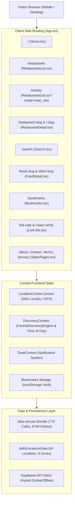

# Product Overview: Menu Maps

**Official Brand Name:** Menu Maps  
**Official Website:** [https://menumaps.in](https://menumaps.in)  
**Primary Market:** Delhi NCR, India  
**Target Audience:** Diners, students, cafe explorers, takeaway customers, and local cafe owners  
**Documentation Scope:** Public Customer-Facing Experience (Excludes internal administration systems)

---

## 1. What is Menu Maps?

Menu Maps is an independent culinary directory and price-transparency platform dedicated to Delhi NCR's dining and cafe culture. The platform provides public access to **100% verified in-store counter menus, real dine-in prices, and direct WhatsApp ordering**, freeing customers and restaurant partners from aggressive 25–40% delivery-aggregator markups.

Unlike traditional delivery apps that inflate food prices, charge platform fees, and levy packaging or surge charges, Menu Maps operates with **0% restaurant commission and 0% consumer markup**. Diners can inspect authentic menus before walking into a venue, calculate their exact counter bill, discover amenities (Wi-Fi, power outlets, metro access, rooftop seating), and initiate direct orders straight to a cafe's verified WhatsApp business counter.

---

## 2. The Core Problem Menu Maps Solves

```
[ Aggregator Delivery Model ]
Restaurant Counter Price: ₹250
+ Aggregator Markup (25–35%): +₹75
+ Packaging Charge: +₹30
+ Delivery & Surge Fee: +₹45
+ Platform Fee & Taxes: +₹15
= Customer Pays: ₹415  (Restaurant pays ~30% commission)

vs.

[ Menu Maps Direct Dining Model ]
Restaurant Counter Price: ₹250
+ Commission: ₹0 (0%)
+ Markup: ₹0 (0%)
= Customer Pays: ₹250  (Customer saves ₹165; Cafe keeps 100% of revenue)
```

1. **Price Inflation on Food Delivery Apps:** Customers ordering online or planning dine-outs regularly pay 25–40% more than the physical storefront price due to aggregator commissions.
2. **Hidden In-Store Information:** Prospective diners visiting popular hubs (Hudson Lane, Connaught Place, Majnu Ka Tila, GK, etc.) lack an authentic digital reference of in-store menus, seating ambience, Wi-Fi availability, or metro station connectivity.
3. **Crushed Margin for Local Cafes:** Independent cafe owners lose 28–35% of each sale to delivery platforms, creating financial strain and incentivizing price inflation.
4. **Frictionless Direct Ordering:** Menu Maps bridges customers and cafe kitchens directly via WhatsApp ordering, preserving counter rates for walk-in, takeaway, and direct local fulfillment.

---

## 3. Who Menu Maps Serves

### Customer Segments
* **College Students & Budget Foodies:** Looking for budget addas (meals under ₹300), late-night snacks, student-friendly cafes with study desks, power outlets, and free Wi-Fi (e.g., North Campus DU, Satya Niketan).
* **Urban Professionals & Remote Workers:** Seeking reliable work-from-cafe spots with quiet seating, verified coffee prices, and proximity to Delhi Metro lines.
* **Neighborhood Diners & Families:** Wanting verified pure-vegetarian options, family-thali pricing, and honest bill estimates before visiting dining destinations across South, West, and Central Delhi.
* **Takeaway & Local Delivery Patrons:** Ordering directly from neighborhood eateries over WhatsApp without aggregator service fees.

### Business Beneficiaries (Customer-Facing Interface)
* **Local Delhi NCR Cafe Owners:** Able to self-list their restaurant for free via `/list-cafe`, verify storefront ownership via `/claim-verify`, and receive commission-free orders over WhatsApp.

---

## 4. What Customers Can Currently Do

1. **Explore 770+ Verified Cafes:** Browse dining spots across 64 distinct Delhi NCR localities, categorized across 9 regional zones.
2. **Search 6,790+ Dish Menus:** Search across thousands of individual dishes with transparent counter pricing, portion sizes, spice levels, and dietary tags.
3. **Smart Location Context & Detection:** Switch seamlessly between "All Delhi NCR" and 64 specific localities or activate live GPS auto-detection to discover cafes within walking distance.
4. **Compare Counter Bills vs. App Markup:** Interactive price calculators (`BillComparisonWidget`, `HonestBillBox`) reveal exact monetary savings on dine-in meals.
5. **Interactive Meal Decision Tools:** 
   - **Spin the Food Wheel:** Randomizer for undecided diners.
   - **Craving Quiz:** 60-second quiz matching mood, budget, and cravings to local cafes.
   - **Dish Roulette:** Cafe-specific item picker on restaurant detail pages.
   - **Table Perk Wheel:** Gamified perks on dine-in meals.
6. **Direct WhatsApp Ordering Drawer:** Build an order cart from verified menu items, choose dine-in/takeaway/delivery, specify table numbers, and launch a formatted WhatsApp message to the kitchen.
7. **Offline Bookmarks Vault:** Save favorite cafes and dishes to a private browser-based vault with zero login requirements and zero personal data tracking.
8. **Metro & Amenity Verification:** Check nearest Delhi Metro station and exit gate, Wi-Fi policies, AC availability, and RO drinking water policies before traveling.

---

## 5. Public Website Architecture



* **Frontend Framework:** React 19 SPA running on Vite 8 with Tailwind CSS v4.
* **Component Chunking:** Code-split modular bundles (`vendor-react`, `vendor-ui`, `vendor-supabase`, `data-venues`, and page-level dynamic imports with auto-retry).
* **Static Snapshot Layer:** Pre-rendered HTML snapshots (`prerender_static_pages.py`) for SEO indexing on 7,573 static URLs.
* **Geospatial Engine:** Pure client-side Haversine distance calculator and 64-locality nearest-neighbor matcher (`src/lib/location.ts`).

---

## 6. Key Customer Journeys at a Glance

1. **Instant Location Discovery:** Customer arrives on `/` -> Navbar detects or prompts for locality -> Feed immediately displays cafes and dishes sorted by proximity.
2. **Search to WhatsApp Order:** Customer searches "Cold Coffee" on `/search` -> Selects cafe -> Adds 2 coffees to cart in `/restaurant/:slug` -> Clicks "Send WhatsApp Order" -> Message opens in WhatsApp with counter total.
3. **Dine-In Menu Inspection:** Customer outside a cafe scans QR code or types `menumaps.in/[slug]` -> Views verified counter prices, water policy, Wi-Fi password, and table perks.
4. **Offline Bookmark Management:** Customer bookmarks a hidden gem -> Re-opens `/bookmarks` on mobile subway commute without active internet -> Views saved counter prices.

---

## 7. Current Product Limitations & Known Gaps

* **Geographic Scope:** Menu Maps is currently restricted to **Delhi NCR** (covering Delhi districts, Noida, Gurugram, and Ghaziabad gateways). Locations outside Delhi NCR fallback to "All Delhi NCR".
* **Payment Processing:** Menu Maps intentionally **does not process online payments or take financial cuts**. All transactions occur directly between customer and cafe (in-person cash/UPI or direct UPI on WhatsApp delivery).
* **Crowdsourced Storefront Photos:** Certain dish images are editorial reference images or storefront captures; disclaimer badges notify users of public storefront sources.
* **Real-Time Seat Booking:** The table reservation module facilitates pre-booking notifications via direct cafe contact rather than a closed-loop electronic table management system.

---

## 8. Verified Facts vs. Unverified Hypotheses

| Feature Area | Verified Fact (Source Code Proven) | Unverified / External Dependency |
|---|---|---|
| **Counter Price Accuracy** | Data is statically compiled from verified venue records across 10 Delhi datasets | Frequency of live price updates by individual physical cafes |
| **0% Commission Guarantee** | No payment gateway code exists; orders redirect directly to `api.whatsapp.com` | Whether individual cafes fulfill WhatsApp delivery themselves or use local runners |
| **Location Discovery** | 64 Delhi localities and 9 zones are mapped with coordinates and metro stations | Accuracy of browser GPS in dense high-rise or basement market areas |
| **Offline Functionality** | Bookmarks and loaded venue data persist in browser localStorage/in-memory cache | Initial network connection required to fetch the static web bundle |
