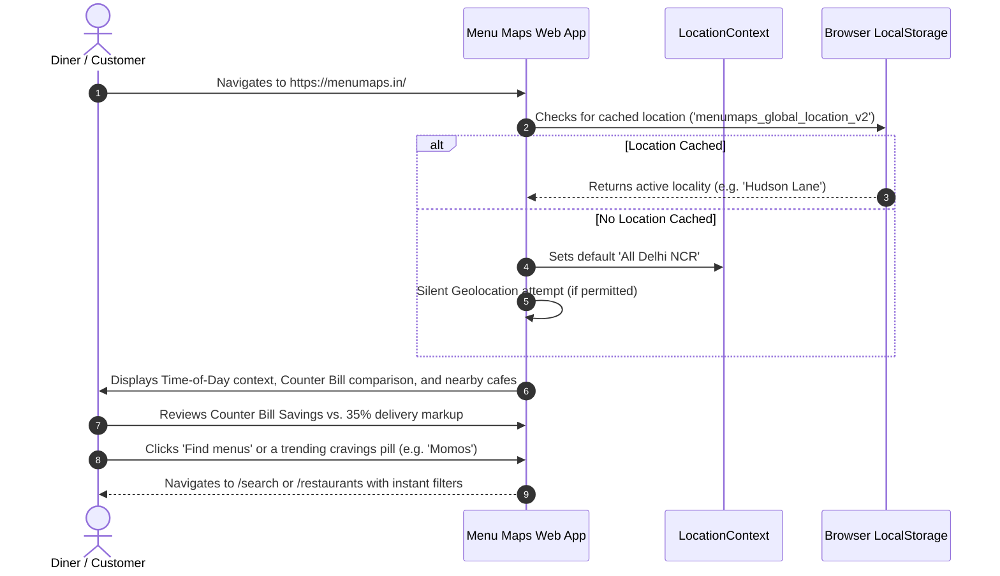
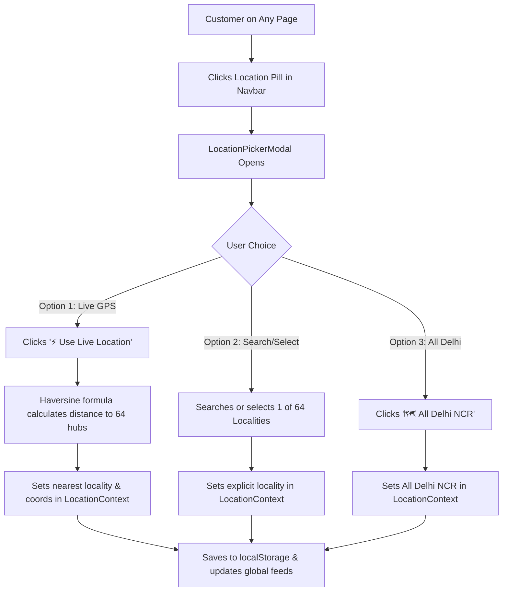
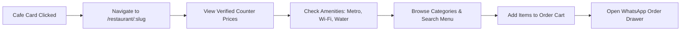

# Customer Journeys: Menu Maps

This document outlines the complete, numbered step-by-step journeys currently supported by the Menu Maps client interface ([https://menumaps.in](https://menumaps.in)). Each journey traces user actions, system responses, state changes, and edge-case behaviors.

---

## Journey 1: Landing on Homepage & Value Proposition Discovery



### Detailed Steps:
1. **Starting Point:** Customer enters `https://menumaps.in/` on desktop or mobile browser.
2. **Initial System Evaluation:**
   - Client checks `localStorage` for `menumaps_global_location_v2`.
   - Dynamic meal context (`getDynamicMealContext()`) inspects device local time to set the meal badge ("Breakfast", "Lunch", "Evening Snacks", "Dinner", or "Late Night").
3. **Hero Experience:**
   - User observes the headline: *"Eat at exact counter prices. Skip delivery app markups."*
   - User reviews the live **Counter Bill Ticket** comparing real dine-in receipts against typical Swiggy/Zomato markups.
4. **Action:** User enters a craving (e.g. "Cold Coffee") or taps an instant pill ("Artisan Coffee").
5. **Resulting State:** Search query is submitted, navigating the user to `/search?q=Coffee` with zero latency.

---

## Journey 2: Selecting or Changing Neighborhood Location



### Detailed Steps:
1. **Starting Point:** Customer clicks the location badge in the desktop Navbar or mobile header.
2. **System Response:** `LocationPickerModal` opens as an accessible dialog (`role="dialog"`). Background scrolling is locked.
3. **Selection Options:**
   - **Method A (Live GPS):** User clicks *"⚡ Use Live Location"*. Browser requests HTML5 geolocation permissions. If granted, coordinates are compared against all 64 Delhi localities using the Haversine formula (`calculateDistanceKm`). The nearest neighborhood is assigned. If the user is outside Delhi (> 40 km), the system defaults to "All Delhi NCR" with an informative toast.
   - **Method B (Search or Scroll):** User types in the search bar (e.g. "Hauz Khas") or scrolls through categorized zone cards. User taps a neighborhood.
   - **Method C (All Delhi NCR):** User clicks the "All Delhi NCR (770+ Cafes)" button.
4. **State Update:**
   - `LocationContext` updates `currentLocation`.
   - Selection persists to `localStorage` (`menumaps_global_location_v2`).
   - Modal closes automatically.
   - A confirmation toast appears (e.g., *"Location set to Hauz Khas Village"*).
   - All restaurant feeds and discovery cards instantly re-rank based on the new proximity center.

---

## Journey 3: Finding Best Cafes Near Me (Distance-First)

1. **Starting Point:** User visits `/nearby` or taps "Best Cafes Near Me" in the footer.
2. **System Response:** 
   - `RestaurantsList` initializes with `initialMode="near_me"`.
   - Default sort order automatically locks to `distance` (nearest first).
   - If geolocation coordinates are available, cafes display precise walking distances (e.g. `150 m` or `1.4 km`).
3. **Filtering:** User refines by selecting *"Pure Veg"* or price tier *"₹"*.
4. **Result:** List immediately updates showing only matching venues sorted strictly from closest to furthest.

---

## Journey 4: Deep Cafe Exploration & In-Store Menu Inspection



### Detailed Steps:
1. **Starting Point:** User clicks on any cafe card across the website.
2. **Navigation:** Router opens `/restaurant/[slug]` (or clean direct route `/[slug]`).
3. **Storefront Verification:**
   - User reviews the "100% Counter Prices Verified" badge and photo gallery.
   - User checks the **Metro connectivity pill** (e.g. "GTB Nagar, Gate 3 - 2 min walk").
   - User checks policies: Free RO drinking water vs. paid bottles, laptop power outlets, and Wi-Fi credentials.
4. **Menu Exploration:**
   - User scrolls through horizontal category tabs ("Specialty Pizzas", "Beverages", "Desserts").
   - User uses the in-menu search bar to find "Iced Latte".
   - Each item displays exact in-store counter price (e.g. `₹180`), portion size, spice rating, and dietary symbol (Veg/Non-veg).
5. **Interactive Play:**
   - Undecided diner clicks "Spin Dish Roulette" to have the app pick a recommended meal.
   - User clicks "Table Perk Wheel" to claim a dine-in discount code.

---

## Journey 5: Commission-Free Direct WhatsApp Ordering

```mermaid
sequenceDiagram
    autonumber
    actor Customer
    participant Detail as RestaurantDetail.tsx
    participant Drawer as WhatsAppOrderDrawer.tsx
    participant WhatsApp as WhatsApp Web / App

    Customer->>Detail: Clicks '+' on 'Cold Coffee (₹140)' & 'Margherita Pizza (₹220)'
    Detail->>Drawer: Opens cart drawer; Total = ₹360
    Customer->>Drawer: Selects fulfillment ('Dine-in at Table' or 'Takeaway')
    Customer->>Drawer: Inputs Table Number 'Table 4'
    Customer->>Drawer: Clicks 'Send Order via WhatsApp'
    Drawer->>WhatsApp: Launches api.whatsapp.com with pre-filled message
    Note over WhatsApp: *New Order via Menu Maps*\n1x Cold Coffee (₹140)\n1x Margherita Pizza (₹220)\nTotal: ₹360 (Counter Rate)\nType: Dine-in (Table 4)
    WhatsApp-->>Customer: Order arrives directly in Cafe's WhatsApp
```

### Detailed Steps:
1. **Starting Point:** Customer is viewing `/restaurant/:slug`.
2. **Action:** Customer clicks the **"+"** button on a menu item card.
3. **Cart Drawer Activation:**
   - `WhatsAppOrderDrawer` slides up from the bottom (or appears as a sticky bottom bar on mobile).
   - Shows live subtotal calculated strictly at counter prices with 0% commission.
4. **Fulfillment Selection:** Customer selects one of three modes:
   - *Dine-in at Table* (prompts for Table Number).
   - *Takeaway / Pickup* (order packed for counter pickup).
   - *Direct Delivery* (prompts for customer delivery address).
5. **Dispatch:** Customer clicks *"Send WhatsApp Order"*.
6. **System Outcome:** Browser triggers a direct link to `https://api.whatsapp.com/send?phone=[cafe_phone]&text=[encoded_order_message]`.
7. **Result:** The cafe kitchen receives the itemized order directly. Zero intermediary fees are deducted.

---

## Journey 6: Private Offline Bookmarks Vault

1. **Starting Point:** User browses any cafe or dish card and taps the bookmark ribbon icon.
2. **System Response:** 
   - `toggleBookmark('restaurant' | 'dish', id)` executes.
   - Item ID is added to `localStorage` key `menumap_bookmarks`.
   - Dispatches a custom window event `menumap_bookmarks_updated`.
   - Navbar and Mobile Bottom Nav badge counters immediately update.
   - Toast notifies user: *"Saved to your private vault"*.
3. **Retrieval:**
   - User navigates to `/bookmarks` (even while offline or in weak connectivity).
   - Vault displays saved **Places** and saved **Dishes** with direct access to counter menus.
4. **Management:**
   - User can remove individual items or click *"Clear Vault"* to purge saved local bookmarks.

---

## Journey 7: Cafe Owner Self-Listing Flow (`/list-cafe`)

1. **Starting Point:** Cafe owner navigates to `/list-cafe` via footer link or promotional banner.
2. **Review:** Owner reads transparency guarantee (0% listing fee, 0% sales commission, free table QR standee).
3. **Information Submission:**
   - Step 1: Cafe Name, City, Locality, Full Street Address, Nearest Metro.
   - Step 2: WhatsApp Number for orders, Primary phone, Cost for two, Pure veg toggle.
   - Step 3: Photo upload of physical storefront and printed paper menu.
4. **Submission Outcome:** Record is stored in pending database, and owner is directed to login or activation instructions.

---

## Journey 8: Error & Empty State Recovery

1. **Invalid URL / 404:**
   - User visits `https://menumaps.in/non-existent-cafe`.
   - System checks `RESERVED_ROUTES`. If slug does not match any valid cafe or route, `NotFound.tsx` renders.
   - Displays user-friendly options: *"Explore Restaurants"*, *"Search Menus"*, or *"Return Home"*.
2. **Zero Search Results:**
   - User searches a query with 0 matches (e.g. "Xyz123").
   - Search page displays clear suggestions: *"Check spelling, try broader keywords like 'Burger', or clear active filters."*
   - Includes a single-tap *"Clear All Filters"* button that restores the default feed.
