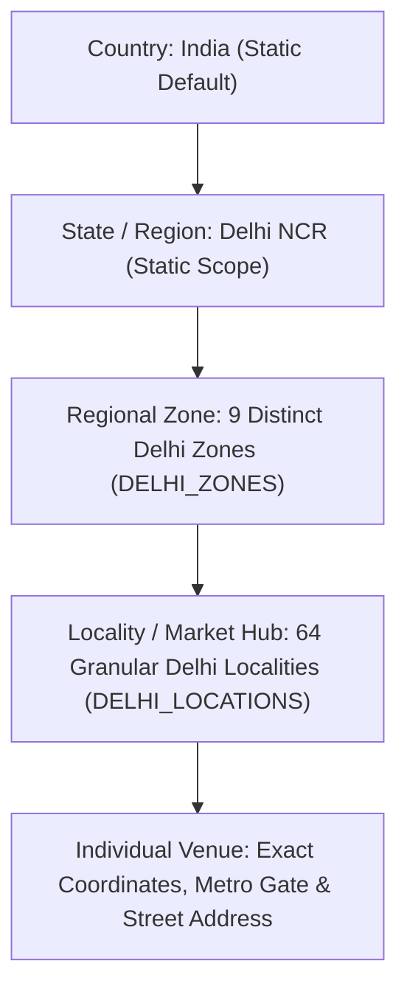

# Location & Discovery System: Menu Maps

This document provides an exhaustive, code-grounded investigation into how location, geospatial awareness, proximity ranking, and neighborhood discovery work across the Menu Maps client application ([https://menumaps.in](https://menumaps.in)).

---

## 1. Supported Location Hierarchy



The Menu Maps location architecture is specifically optimized for **Delhi NCR's unique urban geography**. Rather than generic municipal boundaries, it structures locations around **famous food districts, university student clusters, and Delhi Metro stations**.

### Geographic Levels in Code:
1. **Country:** Statically set to `India` (`IN`).
2. **State / Territory:** `Delhi NCR`.
3. **Zones (9 Regional Clusters):** 
   - North & DU (`north`)
   - South Delhi (`south`)
   - Central & Heritage (`central`)
   - West Delhi (`west`)
   - North-West & NSP (`northwest`)
   - South-West & Dwarka (`southwest`)
   - East & Trans-Yamuna (`east`)
   - NCR Gateways (`ncr`)
   - All Delhi NCR (`all`)
4. **Localities / Neighborhood Food Hubs (64 Granular Hubs):** Specific dining markets such as *Hudson Lane*, *Majnu Ka Tila*, *Hauz Khas Village*, *Connaught Place*, *Shahpur Jat*, *Netaji Subhash Place (NSP)*, *Champa Gali*, *Bengali Market*, etc.
5. **Exact Geospatial Coordinates:** Latitude and longitude (`number`) paired with each venue and locality for Haversine distance calculations.
6. **Transit Anchors (Metro Line & Gate):** Every locality and venue record links to a specific Delhi Metro station, exit gate number, and line color (e.g. *Yellow Line*, *Blue Line*, *Violet Line*).

---

## 2. Location Representation in Code

### The `DelhiLocation` Data Model
Defined in `src/lib/delhiLocationsData.ts`:
```typescript
export interface DelhiLocation {
  id: string;                  // Unique slug: 'hudson-lane', 'hauz-khas-village'
  name: string;                // Full display: 'Hudson Lane (North Campus)'
  shortName: string;           // Compact navbar title: 'Hudson Lane'
  zone: string;                // Zone title: 'North Delhi'
  zoneKey: 'all' | 'north' | 'south' | 'central' | 'west' | 'northwest' | 'southwest' | 'east' | 'ncr';
  latitude: number;            // Geocoordinates (e.g. 28.6942)
  longitude: number;           // Geocoordinates (e.g. 77.2045)
  metroStation: string;        // Station + Exit Gate: 'GTB Nagar (Exit Gate 3)'
  metroLines: string[];        // ['Yellow Line']
  famousSpecialties: string[]; // ['Monster Shakes', 'Kurkure Momos', 'Peri Peri Fries']
  tagline: string;             // 'The iconic DU student adda packed with themed multi-level cafes'
  avgCostForTwo: number;       // Average spend in INR: 450
  isPopularHub: boolean;       // Popularity flag
  pincode?: string;
  landmarks?: string[];
}
```

### The `ActiveLocation` State Model
Defined in `src/context/LocationContext.tsx`:
```typescript
export interface ActiveLocation {
  id: string;                  // 'all' or locality ID (e.g. 'connaught-place')
  name: string;                // 'All Delhi NCR' or 'Connaught Place (CP)'
  shortName: string;           // 'All Delhi' or 'Connaught Place'
  latitude?: number;           // Set when GPS or specific locality is active
  longitude?: number;          // Set when GPS or specific locality is active
  metroStation?: string;       // Nearest metro
  isAllDelhi: boolean;         // True when viewing global directory
  isLiveGps: boolean;          // True when actively populated by browser GPS
}
```

---

## 3. How Customers Experience & Control Location

### A. Global Navbar Location Pill
* **Desktop:** Displayed in the top navigation bar. Contains a pulsing indicator dot (green when live GPS is active, orange when manually set), the short locality name, and a dropdown chevron.
* **Mobile:** Prominently featured in the mobile header alongside direct search.
* **Click Action:** Opens the `LocationPickerModal` with full focus lock.

### B. The `LocationPickerModal` Workflow
1. **Live GPS ("⚡ Use Live Location"):**
   - Triggers `navigator.geolocation.getCurrentPosition()`.
   - Compares coordinates using `calculateDistanceKm()` against all 64 Delhi localities.
   - If user is within 40 km of Delhi, assigns the closest neighborhood, marks `isLiveGps: true`, and updates the UI.
   - If user is outside Delhi (> 40 km), assigns `ALL_DELHI_LOCATION` and notifies the user via Toast.
2. **Global Directory ("🗺️ All Delhi NCR"):**
   - Switches to all 770+ venues across Delhi NCR.
3. **Neighborhood Search Bar:**
   - Real-time search matching locality names, metro stations, landmarks, or zone keywords.
4. **Locality Selection Feed:**
   - Displays 64 locality cards showing zone badges, nearest metro station, and average cost for two.

---

## 4. How Location Affects Search & Results

```
Customer Position / Selected Locality
         │
         ├── User on "All Delhi NCR"
         │     └── Feeds show all 770 venues, sorted by rating or selected criteria
         │
         ├── User selects specific Locality (e.g., "Satya Niketan")
         │     └── Haversine engine calculates distance from Satya Niketan's center
         │     └── Cafes within 3 km ranked highest with "In this Area" badge
         │     └── Nearby cafes within 5–8 km displayed with walking/driving distance
         │
         └── User activates "Live GPS"
               └── Exact device coordinates used for real-time distance sorting
               └── Distances < 1 km shown in meters (e.g., "350 m")
               └── Nearest metro station shown with walking time estimates
```

* **Client-Side Distance Calculation (`calculateDistanceKm`):**
  Uses the standard Haversine spherical formula:
  $$d = 2 R \arcsin \left(\sqrt{\sin^2\left(\frac{\Delta \text{lat}}{2}\right) + \cos(\text{lat}_1) \cos(\text{lat}_2) \sin^2\left(\frac{\Delta \text{lon}}{2}\right)}\right)$$
  Where $R = 6371\text{ km}$.
* **URL Persistence:** Location selection **does not pollute or break public URLs**. The customer can browse `/restaurants`, `/nearby`, or `/search` while their active location persists seamlessly in client memory and `localStorage` (`menumaps_global_location_v2`).

---

## 5. Complete Inventory of 64 Delhi Localities by Zone

### 1. North Delhi & DU Campus (Zone: `north`)
1. **Hudson Lane (North Campus)** — Metro: GTB Nagar (Exit Gate 3), Yellow Line
2. **Vijay Nagar** — Metro: GTB Nagar (Exit Gate 4), Yellow Line
3. **Kamla Nagar** — Metro: Vishwavidyalaya, Yellow Line
4. **Majnu Ka Tila (Chungtown / Tibetan Colony)** — Metro: Vidhan Sabha, Yellow Line
5. **Civil Lines** — Metro: Civil Lines, Yellow Line
6. **Model Town (Main Market & Gujranwala Town)** — Metro: Model Town, Yellow Line
7. **Mukherjee Nagar** — Metro: GTB Nagar, Yellow Line
8. **Shakti Nagar & Roop Nagar** — Metro: Vishwavidyalaya, Yellow Line
9. **Ashok Vihar (Deep Market)** — Metro: Kanhiya Nagar, Red Line

### 2. South Delhi (Zone: `south`)
10. **Hauz Khas Village (HKV)** — Metro: IIT Delhi / Hauz Khas, Yellow & Magenta Line
11. **Green Park & Aurobindo Market** — Metro: Green Park (Exit Gate 2), Yellow Line
12. **Shahpur Jat (Fashion & Cafe Village)** — Metro: Hauz Khas (Exit Gate 3), Yellow Line
13. **Greater Kailash 1 (M & N Block Markets)** — Metro: Greater Kailash, Magenta Line
14. **Greater Kailash 2 (M-Block & Savitri Market)** — Metro: Greater Kailash, Magenta Line
15. **Defence Colony (Main Market)** — Metro: Lajpat Nagar, Pink & Violet Line
16. **Champa Gali & Saidulajab** — Metro: Saket (Exit Gate 2), Yellow Line
17. **Saket (Community Centre & Anupam PVR)** — Metro: Malviya Nagar, Yellow Line
18. **Malviya Nagar (Main Market & Shivalik)** — Metro: Malviya Nagar, Yellow Line
19. **New Friends Colony (NFC Community Centre)** — Metro: Sukhdev Vihar, Magenta Line
20. **CR Park (Chittaranjan Park - Market 1 & 2)** — Metro: Nehru Enclave, Magenta Line
21. **Kailash Colony** — Metro: Kailash Colony, Violet Line
22. **South Extension (Part 1 & Part 2)** — Metro: South Extension, Pink Line
23. **Lajpat Nagar (Central Market & Amar Colony)** — Metro: Lajpat Nagar, Pink & Violet Line
24. **Satya Niketan (South Campus DU)** — Metro: Durgabai Deshmukh South Campus, Pink Line
25. **Anand Lok & Siri Fort** — Metro: Green Park, Yellow Line

### 3. Central & Heritage Delhi (Zone: `central`)
26. **Connaught Place (Inner & Outer Circle)** — Metro: Rajiv Chowk (All Gates), Yellow & Blue Line
27. **Janpath & Tolstoy Marg** — Metro: Janpath, Violet Line
28. **Khan Market** — Metro: Khan Market (Exit Gate 1), Violet Line
29. **Bengali Market** — Metro: Mandi House, Blue & Violet Line
30. **Chandni Chowk (Paranthe Wali Gali & Dariba)** — Metro: Chandni Chowk, Yellow Line
31. **Jama Masjid & Matia Mahal Food Street** — Metro: Jama Masjid (Exit Gate 1), Violet Line
32. **Chawri Bazar & Nai Sarak** — Metro: Chawri Bazar, Yellow Line
33. **Daryaganj** — Metro: Delhi Gate, Violet Line
34. **Pahar Ganj (Backpacker Street)** — Metro: New Delhi / RK Ashram Marg, Blue & Yellow Line
35. **Karol Bagh (Ajmal Khan Road)** — Metro: Karol Bagh, Blue Line
36. **Rajinder Nagar (Old & New)** — Metro: Rajendra Place, Blue Line
37. **Patel Nagar** — Metro: Patel Nagar, Blue Line

### 4. West Delhi (Zone: `west`)
38. **Rajouri Garden (Main Market & BK Dutt)** — Metro: Rajouri Garden, Blue & Pink Line
39. **Punjabi Bagh (Club Road)** — Metro: Punjabi Bagh West, Pink Line
40. **Janakpuri (District Centre & C4E Market)** — Metro: Janakpuri West, Blue & Magenta Line
41. **Tilak Nagar (Central Market & Jail Road)** — Metro: Tilak Nagar, Blue Line
42. **Jail Road Food Strip** — Metro: Tilak Nagar, Blue Line
43. **Paschim Vihar (B-Block & Jwalaheri Market)** — Metro: Paschim Vihar East, Green Line
44. **Vikaspuri (PVR Complex & Community Centre)** — Metro: Janakpuri West, Blue Line
45. **Uttam Nagar (East & West)** — Metro: Uttam Nagar East, Blue Line
46. **Kirti Nagar (Furniture Block & Moments)** — Metro: Kirti Nagar, Blue & Green Line
47. **Tagore Garden** — Metro: Tagore Garden, Blue Line

### 5. North-West Delhi (Zone: `northwest`)
48. **Netaji Subhash Place (NSP Towers & Food Court)** — Metro: Netaji Subhash Place, Red & Pink Line
49. **Pitampura (Kapil Vihar & Rani Bagh)** — Metro: Pitampura, Red Line
50. **Rohini Sector 7, 8 & 9 Food Hub** — Metro: Rohini West, Red Line
51. **Rohini Sector 14 & DC Chowk** — Metro: Rohini East, Red Line
52. **Prashant Vihar** — Metro: Rohini Sector 18, Yellow Line
53. **Nangloi (Rohtak Road & Metro Station)** — Metro: Nangloi, Green Line

### 6. South-West Delhi (Zone: `southwest`)
54. **Aerocity (Worldmark Food Walk)** — Metro: Delhi Aerocity, Airport Express Line
55. **Vasant Kunj (Sector B, C & Malls)** — Metro: Chhatarpur, Yellow Line
56. **Vasant Vihar (Basant Lok Community Centre)** — Metro: Vasant Vihar, Magenta Line
57. **Dwarka Sector 6 & 10 Central Market** — Metro: Dwarka Sector 10, Blue Line
58. **Dwarka Sector 12 & City Centre** — Metro: Dwarka Sector 12, Blue Line
59. **Dwarka Sector 21 (Vegas Mall Hub)** — Metro: Dwarka Sector 21, Blue & Airport Express Line

### 7. East Delhi & Trans-Yamuna (Zone: `east`)
60. **Laxmi Nagar (Vikas Marg Food Strip)** — Metro: Laxmi Nagar, Blue Line
61. **Preet Vihar (Community Centre)** — Metro: Preet Vihar, Blue Line
62. **Mayur Vihar Phase 1 (Acharya Niketan)** — Metro: Mayur Vihar 1, Blue & Pink Line
63. **Karkardooma (Cross River Mall)** — Metro: Karkardooma, Blue & Pink Line
64. **Shahdara & Dilshad Garden** — Metro: Shahdara, Red Line

---

## 6. Known Gaps & Future Considerations

* **Out-of-State Coordinates:** Customers opening Menu Maps from outside Delhi NCR (e.g. Mumbai, Bengaluru, international) are automatically routed to "All Delhi NCR". Live GPS does not show venues in non-Delhi cities because Menu Maps is strictly focused on Delhi NCR at present.
* **Offline Geolocation Limitations:** When offline, browser GPS can still acquire coordinates via hardware GPS chips on mobile phones, but cannot query reverse geocoders; Menu Maps solves this by calculating distance purely client-side against the offline `DELHI_LOCATIONS` coordinate table.
