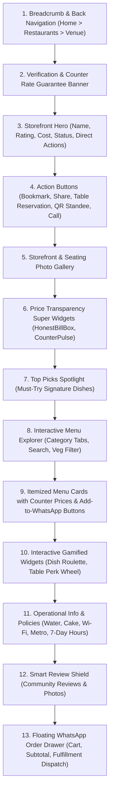

# Cafe Pages & Menu Experience: Menu Maps

This document details the exact customer-facing presentation, structure, data elements, and interactive experiences implemented on cafe listings, individual restaurant storefronts, and dish menus across Menu Maps ([https://menumaps.in](https://menumaps.in)).

---

## 1. The Cafe Listing Card (`RestaurantCard.tsx`)

The `RestaurantCard` component is the primary visual unit of discovery across the Homepage, Explore Directory (`/restaurants`), Best Cafes Near Me (`/nearby`), and Bookmarks (`/bookmarks`).

```
┌──────────────────────────────────────────────────────────┐
│ [ Cover Image (16:10 ratio with hover zoom)            ] │
│ [ 🏷️ Top Cuisine ]           [ 🔖 Bookmark Ribbon Button] │
│ [ 🚶 350 m • 4 min walk ]                                │
├──────────────────────────────────────────────────────────┤
│ The Hudson Cafe                                          │
│ ⭐ 4.4 (1,280 reviews) • ₹450 for two                    │
│ 📍 Hudson Lane, North Campus • 🚇 GTB Nagar (Gate 3)     │
├──────────────────────────────────────────────────────────┤
│ 🏷️ "Lasagna" • "Red Velvet Waffle" • "Loaded Nachos"     │
│ [🟢 Pure Veg Available]   [📶 Free Wi-Fi]   [⚡ Outlets] │
└──────────────────────────────────────────────────────────┘
```

### Displayed Information:
1. **Visual Cover:** High-quality food or seating photo (`cover_image_url`) with lazy loading and fallback placeholders.
2. **Proximity Badge:** If coordinates exist, displays live walking/driving distance (e.g. `250 m` or `1.8 km`).
3. **Bookmark Button:** Interactive heart/ribbon icon allowing immediate saving to the private offline vault.
4. **Primary Identity:** Restaurant name (`name`), primary cuisine tags (`cuisine_types`), and overall star rating (`rating_avg`).
5. **Cost for Two:** Average spend in INR (e.g. `₹450 for two`).
6. **Transit & Locality:** Address line 1, locality name, nearest Delhi Metro station, and exit gate.
7. **Known-for Dishes Pill:** Highlight tags showing signature items.
8. **Amenity Badges:** Mini icons for Free Wi-Fi (`Wifi`), pure veg (`Leaf`), power outlets, and AC.

---

## 2. Individual Cafe Page Structure (`RestaurantDetail.tsx`)

The single restaurant detail page is an exhaustive digital storefront designed to give customers total clarity before visiting or ordering.

### Top-to-Bottom Layout Breakdown:



### Detailed Section Attributes:

#### Section 1: Storefront Hero & Identity
* **Name & Verification:** Displays verified checkmark (`ShieldCheck`) confirming counter prices have been validated.
* **Operational Status:** Displays live green badge `Open Now` or red badge `Closed`, accompanied by today's operational hours (e.g. `11:00 AM – 11:30 PM`).
* **Direct Actions:**
  - *Call Venue:* Initiates phone dialer with verified contact number (`tel:...`).
  - *Directions:* Launches Google Maps navigation with exact coordinates (`https://www.google.com/maps/dir/?api=1&destination=lat,lng`).
  - *Dine-In QR Standee:* Opens `RestaurantQrModal` rendering a printable, scannable table QR code.
  - *Reserve Table:* Opens `TableReservationModal` capturing reservation details.
  - *Share:* Opens `SocialShareModal` to copy direct clean links or share to WhatsApp.

#### Section 2: Storefront Photo Gallery
* Displays verified high-resolution storefront photos, dining areas, interior ambience, and customer photos.
* Categorized by: *All Photos*, *Ambience & Seating*, *Food & Menus*.

#### Section 3: Transparency Super Widgets
* **`HonestBillBox`:** Real receipt simulator showing how a ₹500 counter meal costs ₹720+ on delivery apps due to commissions, delivery fees, and packaging charges.
* **`CounterPulseTicker`:** Live social-proof counter displaying how many diners verified this menu today.
* **`TopPicksSpotlight`:** Carousel highlighting the 3 highest-rated signature dishes.

#### Section 4: Operational Policies & Amenities
Menu Maps verifies critical in-person dining details that aggregators ignore:
1. **Drinking Water Policy (`water_policy`):**
   - `free_ro`: Free filtered RO drinking water served on request.
   - `paid_bottle`: Only packaged mineral water available for purchase.
   - `both`: Both free RO and packaged water provided.
2. **Outside Cake Policy (`cake_policy`):**
   - `free`: Outside birthday/celebration cakes allowed with zero charge.
   - `charges_cutting_fee`: Cake cutting fee levied (e.g., `₹200 fee`).
   - `not_allowed`: Outside food/cakes strictly prohibited.
3. **Laptop Work-Friendly Amenities:**
   - Free high-speed Wi-Fi with password policy.
   - Dedicated electrical power plug points at dining tables.
4. **Transit Accessibility:**
   - Nearest Delhi Metro Station name, line color badge, exit gate number, and estimated walking time.
5. **Full Weekly Schedule:**
   - Expandable 7-day schedule (Monday to Sunday) showing exact opening and closing times.

---

## 3. The Menu Browsing Experience

### Category Navigation
* Rendered as a sticky, horizontally scrollable pill strip:
  `All Dishes` | `Starters & Quick Bites` | `Woodfired Pizzas` | `Pasta & Continental` | `Beverages & Cold Brews` | `Desserts & Waffles`
* Tapping a category smoothly scrolls the viewport to that specific section.

### In-Menu Search & Dietary Filters
* **Search Input:** Fast client-side filter searching names and descriptions in real-time.
* **Pure Veg Toggle:** Instant toggle filtering out all non-vegetarian items.

### The Menu Item Card
Each menu item is rendered with full pricing transparency:
* **Item Name & Description:** e.g., *"Signature Red Velvet Waffle - Crisp Belgian waffle topped with fresh whipped cream, cream cheese drizzle, and white chocolate shavings."*
* **Exact Counter Rate:** Large, bold counter price in INR (e.g., `₹180`).
* **App Savings Indicator:** Small badge showing estimated delivery savings (e.g. `Save ~₹65 in-store`).
* **Dietary Icon:** Standard FSSAI color symbols:
  - 🟢 Green dot in square = Vegetarian
  - 🟤 Brown triangle in square = Non-Vegetarian
  - 🟡 Yellow dot = Egg
  - 🌿 Leaf = 100% Vegan
* **Portion Size:** Portion or serving detail (e.g. *"2 Pieces"*, *"Regular (300ml)"*, *"Serves 1-2"*).
* **Spice Meter:** Visual rating from 0 to 5 chillies (`🌶️`).
* **Order Action:** Quantity counter (`-` / `+`) and *"Add to WhatsApp Order"* button.

---

## 4. The Direct WhatsApp Ordering Experience (`WhatsAppOrderDrawer.tsx`)

When a customer adds one or more items to their cart, the `WhatsAppOrderDrawer` activates.

### Fulfillment Options:
1. **Dine-in at Table:** Customer inputs their table number (e.g. *"Table 4"*). The kitchen receives the order directly without requiring waitstaff paper tickets.
2. **Takeaway / Counter Pickup:** Customer specifies self-pickup. The kitchen begins preparation for walk-in collection.
3. **Direct Delivery:** Customer inputs their local delivery address. The cafe fulfills the delivery directly without paying a 30% delivery commission.

### Order Dispatch Message:
Clicking *"Send Order via WhatsApp"* launches `https://api.whatsapp.com/send` with the following clean payload:
```
🍽️ *NEW ORDER via Menu Maps*
━━━━━━━━━━━━━━━━━━━━━━
*Restaurant:* The Hudson Cafe
*Order Type:* Dine-in at Table (Table 4)

*Itemized Order:*
• 2x Cold Coffee (₹140) = ₹280
• 1x Penne Arrabiata (₹220) = ₹220
• 1x Red Velvet Waffle (₹180) = ₹180

━━━━━━━━━━━━━━━━━━━━━━
*Total Bill:* ₹680 (Exact Counter Price)
*(No Aggregator Markup • Direct Storefront Order)*
```

---

## 5. Gamified Interactive Experiences

1. **`DishRouletteModal` (Dish Roulette):**
   - For diners who cannot decide what to order at a specific cafe.
   - Spins a graphic roulette wheel featuring available dishes from the current restaurant.
   - Highlights the winning dish with photo, price, and instant "Add to Order" action.
2. **`TablePerkWheelModal` (Table Perk Wheel):**
   - A playful promotional wheel diners can spin while seated at the table.
   - Generates fun perks (e.g., *"10% off bill"*, *"Free extra dip"*, *"Free dessert on orders above ₹500"*).
   - Prompts diner to show the screen to the cafe manager.
